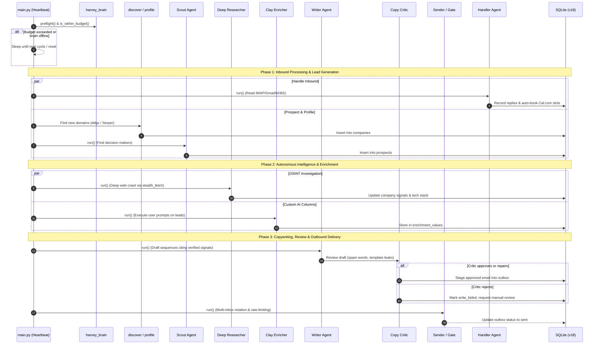
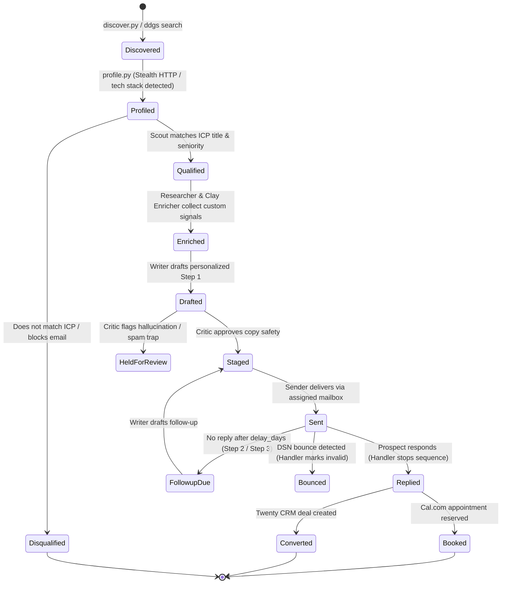

# 🏛️ Harvey Agent (Sellbird) — Technical Architecture Specification

```
  █████╗ ██████╗  ██████╗██╗  ██╗██╗████████╗███████╗ ██████╗████████╗██╗   ██╗██████╗ ███████╗
 ██╔══██╗██╔══██╗██╔════╝██║  ██║██║╚══██╔══╝██╔════╝██╔════╝╚══██╔══╝██║   ██║██╔══██╗██╔════╝
 ███████║██████╔╝██║     ███████║██║   ██║   █████╗  ██║        ██║   ██║   ██║██████╔╝█████╗  
 ██╔══██║██╔══██╗██║     ██╔══██║██║   ██║   ██╔══╝  ██║        ██║   ██║   ██║██╔══██╗██╔══╝  
 ██║  ██║██║  ██║╚██████╗██║  ██║██║   ██║   ███████╗╚██████╗   ██║   ╚██████╔╝██║  ██║███████╗
 ╚═╝  ╚═╝╚═╝  ╚═╝ ╚═════╝╚═╝  ╚═╝╚═╝   ╚═╝   ╚══════╝ ╚═════╝   ╚═╝    ╚═════╝ ╚═╝  ╚═╝╚══════╝
 ── DEEP TECHNICAL SPECIFICATION, DATA FLOWS & STATE MACHINES ─────────────────────────────────────
```

---

## 1. System Topology & Architectural Layers

Harvey Agent is structured into **four distinct decoupled architectural layers**:

```mermaid
flowchart TD
    subgraph UI_Layer["1. Presentation & Control Layer"]
        CLI["CLI (sellbird.cli)"]
        DASH["FastAPI Dashboard (:5555)"]
        TRAY["Windows System Tray"]
        MCP["MCP Server (AI Coding Agents)"]
    end

    subgraph Orchestration_Layer["2. Multi-Agent Orchestration Layer"]
        MAIN["Heartbeat Loop (15-min tick)"]
        SCOUT["Scout (ICP & Decision Maker)"]
        RES["Deep Researcher (OSINT Web)"]
        ENR["Clay Enricher (Custom AI)"]
        WRITER["Writer (Cold Sequences)"]
        CRITIC["Copy Critic (Deliverability)"]
        SENDER["Sender (Multi-Inbox Rotation)"]
        HANDLER["Handler (Replies & Auto-Book)"]
        ANALYST["Analyst (Diagnostics)"]
    end

    subgraph Intelligence_Layer["3. Intelligence & Routing Layer (harvey_brain)"]
        ROUTER["RouterTransport (Fallback Chain)"]
        PROFILES["Role Profiles (scout, writer, etc.)"]
        OA_COMPAT["OpenAICompatTransport (/chat/completions)"]
        SCHEMAS["Strict JSON Schema Normalizer"]
        BUDGET["Budget & Usage Ledger ($USD Guard)"]
    end

    subgraph Persistence_Layer["4. State & Infrastructure Layer"]
        SQLITE["SQLite Database (Schema v18, WAL Mode)"]
        STEALTH["Stealth Fetch Waterfall (curl_cffi/Playwright)"]
        MAIL["Mail Providers (Gmail / M365 / SMTP)"]
        CAL["Calendar (Cal.com v2 / GCal)"]
        CRM["Twenty CRM & Webhooks"]
    end

    UI_Layer --> Orchestration_Layer
    Orchestration_Layer --> Intelligence_Layer
    Orchestration_Layer --> Persistence_Layer
    Intelligence_Layer --> Persistence_Layer
```



---

## 2. End-to-End Execution Flow (The 15-Minute Cycle)

Every 15 minutes, `main.py` wakes up, evaluates quiet hours andrecipients' time zones, and dispatches tasks:



---

## 3. Lead & Campaign State Machine



---

## 4. SQLite Schema v18 Architecture

The state layer (`sellbird/state.py`) runs in SQLite WAL mode (`PRAGMA journal_mode=WAL; PRAGMA synchronous=NORMAL; busy_timeout=5000;`).

### 4.1 Primary Entity Tables
1. **`companies`**:
   - `id` (TEXT PRIMARY KEY), `domain` (UNIQUE), `name`, `website`, `industry`, `location`
   - `signals` (JSON text): verified observation codes (`RUNNING_GOOGLE_ADS`, `HIRING_ROLE`, etc.)
   - `tech_stack` (JSON text): detected technologies (`Shopify`, `HubSpot`, `PostgreSQL`)
   - `fit_score` (INT), `status` (`new`, `active`, `contacted`, `converted`, `rejected`)
2. **`prospects`**:
   - `id` (TEXT PRIMARY KEY), `company_id` (FK -> companies.id)
   - `first_name`, `last_name`, `email` (TEXT), `email_status` (`verified`, `risky`, `guess`, `invalid`)
   - `title`, `seniority` (`c_suite`, `vp`, `director`, `owner`), `linkedin_url`
   - `status` (`new`, `queued`, `contacted`, `replied`, `opted_out`)
3. **`outbox`**:
   - `id` (TEXT PRIMARY KEY), `prospect_id` (FK), `company_id` (FK), `campaign_id` (FK)
   - `mailbox_id`: assigned inbox for sending
   - `subject`, `body_text`, `body_html`, `step_index` (INT)
   - `scheduled_at`, `status` (`draft`, `approved`, `sending`, `sent`, `failed`, `held`)
4. **`conversations`**:
   - `id` (TEXT PRIMARY KEY), `prospect_id`, `campaign_id`, `mailbox_id`
   - `thread_id`, `in_reply_to`, `status` (`open`, `booked`, `archived`)
5. **`enrichment_columns` (Migration v18)**:
   - `id` (TEXT PRIMARY KEY), `name`, `prompt`, `use_web_search` (BOOL), `output_format` (`text`, `number`, `boolean`), `created_at`
6. **`enrichment_values` (Migration v18)**:
   - `company_id` (TEXT), `column_id` (TEXT), `value` (TEXT), `status` (`done`, `pending`, `failed`), `updated_at`
   - PRIMARY KEY (`company_id`, `column_id`)
7. **`usage_events`**:
   - `id` (TEXT PRIMARY KEY), `timestamp`, `provider`, `model`, `agent`
   - `input_tokens`, `output_tokens`, `cache_read_tokens`, `cost_usd`

---

## 5. Security & Isolation Model

1. **SSRF Pre-Validation**: Every URL entered by users or found via search is strictly validated by `validate_public_url()` before any network client connects:
   - Prohibits IPv4 loopback (`127.0.0.0/8`), RFC 1918 private subnets (`10.0.0.0/8`, `172.16.0.0/12`, `192.168.0.0/16`), link-local (`169.254.0.0/16`), and IPv6 loopback (`::1`).
   - Requires explicit scheme (`http` or `https`).
2. **Dashboard Host Restraint**: The FastAPI dashboard is hardcoded to bind to loopback addresses (`127.0.0.1` or `localhost`). Remote access requires an explicit proxy or SSH tunnel.
3. **Local Credential Storage**: All API keys, passwords, and tokens are stored exclusively on disk in `.env` and `data/dashboard-token`. Credentials are never transmitted to telemetry or external logs.
4. **Windows Process Isolation**: Subprocesses running PowerShell or background tasks use Win32 `CREATE_NO_WINDOW` flags to prevent disruptive terminal popups.
