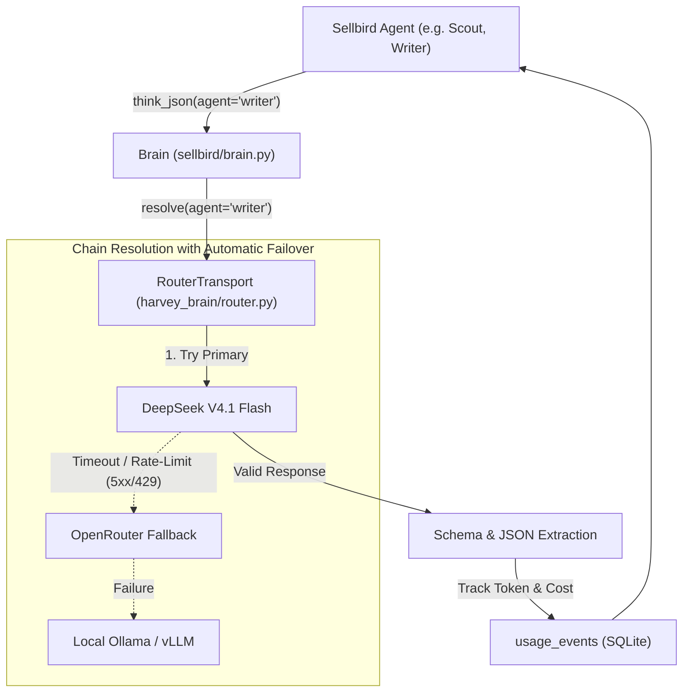

# Sellbird — Master Handoff & Small Model Operating Guide

```
  ███████╗███████╗██╗     ██╗     ██████╗ ██╗██████╗ ██████╗
  ██╔════╝██╔════╝██║     ██║     ██╔══██╗██╗██╔══██╗██╔══██╗
  ███████╗█████╗  ██║     ██║     ██████╔╝██╗██████╔╝██║  ██╗
  ╚════██║██╔══╝  ██║     ██║     ██╔══██╗██╗██╔══██╗██║  ██╗
  ███████╗███████╗███████╗███████╗██████╔╝██║  ██║██████╔╝
  ╚══════╝╚══════╝╚══════╝╚══════╝╚═════╝ ╚═╝╚═╝  ╚═╝╚═════╝
  ── AUTONOMOUS AI OUTREACH & MULTI-AGENT GTM PLATFORM ──────
```

> **Target Audience**: This document is specifically engineered as a complete, self-contained handoff for **developers** and **smaller AI models (e.g., DeepSeek V4.1 Flash, Qwen 2.5, Llama 3)** that need explicit, step-by-step guidance, full context, exact commands, and architecture rules to operate, debug, and expand this codebase without ambiguity.

---

## 1. System Overview & Executive Summary

**Sellbird** (formerly Harvey, open-source, licensed under AGPL-3.0) is a fully autonomous, local-first Outbound Sales & Go-To-Market (GTM) execution engine.

### Core Superpowers & Key Upgrades
1. **Zero `claude login` Requirement**: Any model with an OpenAI-compatible endpoint (`/chat/completions`) can power the entire pipeline via `brain.transport_factory`. Models like **DeepSeek V4.1 Flash**, **Gemini 2.5/3.8 Flash**, **Groq Llama 3.3**, or local **Ollama / vLLM** run natively. Claude Code (the default) and Codex remain first-class providers.
2. **Provider Failover & Cost-Aware Routing (`harvey_brain`)**: A multi-tiered fallback chain automatically fails over from primary models to secondary providers upon timeouts or rate limits. Per-role routing allows assigning lightweight, fast models (DeepSeek Flash) to high-volume prospecting/scoring while routing creative copywriting to reasoning models.
3. **Stealth OSINT Scraping Waterfall**: 3-tier SSRF-guarded fetch engine combining `curl_cffi` (browser TLS impersonation), headless Playwright (SPA execution), and `trafilatura` for clean, ads-free Markdown extraction.
4. **Clay-Style Custom AI Columns**: Dynamically create custom enrichment columns in SQLite, execute autonomous AI web investigations per lead, and display them in the web dashboard.
5. **Auto-Booking & Multi-Channel Integrations**: Cal.com booking webhooks, Twenty CRM synchronization (lead events, do-not-contact pull, observation custom fields), and instant Telegram/Slack operator copilot alerts.
6. **Deliverability & Safety Firewall**: CopyCritic agent verifies all emails before sending, preventing hallucinated facts, spam trigger phrases, and unresolved merge-tag traps (`{{first_name}}`).

---

## 2. Quick Start: How to Run and Test

The environment uses **Python 3.11+** with the virtual environment at the repository root (`.venv/`).

### 2.1 Activate Virtual Environment & Check Status
```bash
# macOS / Linux:
cd /path/to/sellbird
source .venv/bin/activate

# Verify the CLI is functional:
sellbird status
```

### 2.2 Configure AI Model Keys (`.env` & `brain.yaml`)
To run with **DeepSeek V4.1 Flash** (or any OpenAI-compatible API):
1. Open `.env` (or configure via Dashboard Settings):
```env
DEEPSEEK_API_KEY=sk-your-deepseek-key-here
# Or for a custom / local OpenAI-compatible endpoint:
# OPENAI_BASE_URL=https://api.deepseek.com/v1
# OPENAI_MODEL=deepseek-chat
# OPENAI_API_KEY=sk-your-key-here
```

2. Review `brain.yaml` (at the repository root):
```yaml
budget:
  max_usd_per_day: 5.0

chain:
  - provider: deepseek
    model: deepseek-chat
    api_key_env: DEEPSEEK_API_KEY
  - provider: openrouter
    model: deepseek/deepseek-chat
    api_key_env: OPENROUTER_API_KEY

profiles:
  scout:
    model: deepseek-chat
    temperature: 0.1
  writer:
    model: deepseek-chat
    temperature: 0.7
  researcher:
    model: deepseek-chat
    temperature: 0.2
  enricher:
    model: deepseek-chat
    temperature: 0.2
  critic:
    model: deepseek-chat
    temperature: 0.0
```

### 2.3 Run Diagnostic Checks
```bash
# 1. Run Brain Doctor (verifies all configured model providers)
sellbird brain doctor

# 2. Check Overall Pipeline Status
sellbird status
```

### 2.4 Start the Web Dashboard
```bash
sellbird dashboard
# Prints the private unlock link (http://127.0.0.1:5555/#token=…);
# sellbird dashboard --url prints it again.
```

### 2.5 Start the Autonomous Outbound Loop
```bash
sellbird run
```

---

## 3. Repository Architecture & Directory Layout

```
sellbird/
├── sellbird/                     # Package root
│   ├── main.py                   # 15-minute heartbeat loop & signal control
│   ├── cli.py                    # Command line interface & ASCII art banner
│   ├── dashboard.py              # FastAPI web server (:5555) & REST API
│   ├── brain.py                  # Bridge connecting Sellbird to harvey_brain
│   ├── bandit.py                 # Thompson-sampling framework optimizer
│   ├── state.py                  # SQLite StateManager (schema v20, WAL mode)
│   ├── deliverability.py         # DNS checks (deep SPF/DMARC via checkdmarc)
│   ├── site_facts.py              # Company observation & facts extraction
│   │
│   ├── agents/                   # Multi-Agent Roster
│   │   ├── scout.py              # ICP qualification & decision-maker discovery
│   │   ├── writer.py             # Cold email copywriting & sequence generator
│   │   ├── researcher.py         # Autonomous OSINT deep web investigation
│   │   ├── enricher.py           # Clay-style custom AI column evaluator
│   │   ├── critic.py             # Hallucination, spam & merge-tag reviewer
│   │   ├── sender.py             # Multi-inbox rotation & rate-limited delivery
│   │   ├── handler.py            # Bounce processing, reply reading & auto-booking
│   │   └── analyst.py            # Pipeline analytics & funnel metrics
│   │
│   ├── collectors/               # Data Collection
│   │   ├── discover.py           # The only stage that spends money
│   │   ├── ats.py                # Greenhouse/Lever/Ashby/Workable board reads
│   │   └── competitor_watch.py   # Scheduled page-change monitor
│   │
│   ├── integrations/             # Third-Party Connectors
│   │   ├── stealth_fetch.py      # 3-tier SSRF-guarded stealth web scraper
│   │   ├── calendar.py           # Cal.com / Google Calendar booking
│   │   ├── crm_sync.py           # Twenty CRM REST sync (outbound + inbound)
│   │   ├── copilot.py            # Telegram Bot API & Slack webhook alerts
│   │   ├── gmail.py              # Google Workspace OAuth2 email sender
│   │   ├── microsoft.py          # Microsoft Graph OAuth2 email sender
│   │   ├── smtp_mail.py          # Custom SMTP/IMAP mailbox provider
│   │   └── email_finder.py       # Pattern discovery & MX validation
│   │
│   └── web/                      # Dashboard front end (no build step)
│       ├── index.html            # UI layout & modal dialogs
│       ├── app.js                # Frontend controllers (Brain Studio, Clay AI)
│       └── app.css               # Light/dark themes, one token set
│
├── harvey_brain/                 # Universal LLM Router Engine
│   ├── spec.py                   # Provider specifications (DeepSeek, Groq, xAI, etc.)
│   ├── config.py                 # Config loader, brain.yaml & .env discovery
│   ├── openai_compat.py          # Universal OpenAI /chat/completions transport
│   ├── router.py                 # Multi-provider fallback loop & budget tracking
│   ├── profile.py                # Per-role overrides (scout, writer, researcher)
│   ├── router_factory.py         # Factory constructing RouterTransport from config
│   ├── schemas.py                # Strict task JSON schemas & 400 auto-downgrade
│   └── probe.py                  # CLI diagnostic probe
│
├── tests/                        # Comprehensive Pytest Suite (3,800+ tests)
└── data/                         # Local SQLite Storage & Logs (created on first run)
    └── sellbird.db               # SQLite DB (schema v20 with enrichment tables)
```

---

## 4. Subsystem Deep Dive: How the Core Works

### 4.1 Brain Router v2 (`harvey_brain`)



- **Per-Call Model Overrides**: When `scout` runs, `profile.py` overrides the request model to `deepseek-chat` and temperature to `0.1` without rebuilding the transport.
- **Strict Structured Output & Auto-Downgrade**: If an endpoint rejects `json_schema` strict mode with HTTP 400 or 422, `OpenAICompatTransport` automatically downgrades to `json_object` and retries seamlessly.
- **Budget Protection**: Daily spend is accumulated in SQLite. If cumulative spend hits `max_usd_per_day` (default `$5.00`), further LLM calls pause to prevent runaway billing.

### 4.2 3-Tier Stealth Web Waterfall (`stealth_fetch.py`)
When researching a company website or scraping job listings:
1. **Tier 1 — `curl_cffi`**: Performs HTTP requests with TLS browser fingerprints (Chrome 120 / Safari 17) to bypass Cloudflare and basic anti-bot blocks at zero cost.
2. **Tier 2 — Headless Playwright**: If HTML is an empty Single Page App shell (`is_spa_shell`), renders JavaScript locally.
3. **Tier 3 — Firecrawl / Jina Reader**: Cloud fallback for difficult anti-bot systems.
4. **Mandatory SSRF Guard**: `validate_public_url()` blocks loopback (`127.0.0.1`, `localhost`), link-local (`169.254.169.254`), private IP subnets (`10.0.0.0/8`, `172.16.0.0/12`, `192.168.0.0/16`), and non-HTTP protocols.

### 4.3 Clay-Style Custom AI Columns (`enricher.py`)
Allows users to define dynamic columns like *"Tech Stack Analysis"* or *"Founder Background"*:
- Columns are defined in `enrichment_columns` (SQLite).
- `ClayEnricher` runs on un-enriched leads, collects domain facts, prompts the model (`agent="enricher"`), and stores structured outputs in `enrichment_values`.

### 4.4 Deliverability & Safety Critic (`critic.py`)
Before any email is staged to `outbox`:
1. Scans for template leakage: literal `{{first_name}}`, `{{company}}`, `[First Name]`.
2. Scans for spam keywords: *"guaranteed 100%"*, *"no risk"*, *"make money fast"*.
3. Verifies that claims cite actual signals stored in `companies.signals`.
4. If issues are found, prompts the Critic role to repair the email copy automatically.

### 4.5 Framework Experiment (`bandit.py`)
When `writer.frameworks` lists two or more copywriting frameworks (e.g. `pas`, `bab`), each campaign is written in one and tagged. The next campaign's framework is chosen by Thompson sampling over real reply outcomes (`state.framework_stats()`), so winning shapes gradually earn more traffic. The dashboard's Campaigns tab shows per-framework reply rates. Off by default: the built-in writer shape runs alone.

### 4.6 Twenty CRM Sync (`integrations/crm_sync.py`)
Three directions, all opt-in, all Twenty REST:
- **Lead events out** (`CRMSyncClient`): hot replies, accepted offers and booked meetings create/update a Person, and an Opportunity on high-intent events.
- **Do-not-contact in** (`TwentyInboundSync`): people whose custom boolean (`crm.inbound_field`, default `doNotContact`) is true are suppressed here (`reason='imported'`), so a blocklist kept in Twenty actually holds.
- **Observations out** (`TwentyObservationSync`): each company's newest mapped signal finding (`crm.observation_fields`: signal code → field) is written to its Twenty Company record via `PATCH /rest/companies/{id}`, matched by domain. Unchanged findings cost nothing: the last pushed values and Twenty's company id are remembered in settings.

### 4.7 Competitive Intelligence Tracker (`collectors/competitor_watch.py`)
`competitor_watch` in sellbird.yaml names pages to watch (a rival's pricing page, their careers page). On idle cycles each page is fetched through the stealth waterfall and compared against a stored baseline; a change alerts the operator (Telegram/Slack + the Activity log) and moves the baseline forward. No model calls, and findings never reach cold emails.

---

## 5. Golden Rules for Smaller Models (DeepSeek V4.1 Flash)

When writing code or adding features to this repository, smaller reasoning models **MUST** strictly adhere to the following rules:

1. **Defensive Dict Extraction**: Never assume LLM JSON output is cleanly formatted. Always parse with `sellbird.brain._extract_json()` and handle both `list` and `dict` top-level wrapping.
2. **Backward-Compatible Signatures**: When adding keyword arguments to agent methods (e.g., `company_id`), always provide default values (`company_id: str = ""`) and wrap calls in `try/except TypeError` so mock fixtures in existing tests don't break.
3. **SQLite WAL Mode & Connection Pool**: Always access SQLite via `StateManager` or `storage.connect(path)` with `PRAGMA synchronous=NORMAL` and `busy_timeout=5000`. Never hold open long transactions across async `await` sleeps.
4. **Mandatory URL SSRF Validation**: Any web fetching feature **must** call `validate_public_url(url)` before sending an HTTP request.
5. **Clean Resource Lifecycles**: Always call `await brain.aclose()` inside `finally` blocks to close active `httpx.AsyncClient` connection pools and avoid socket leaks.
6. **No Real People in the Repo**: This is a public repository. Never add a real person's or business's name, email, phone or address to code, tests, docs, commits or PR text — fictional `example.com`-style data only (see CONTRIBUTING.md).
7. **No Raw Emojis in Dashboard UI**: Per UI design standards, use clean SVG icons (`<svg class="icon"><use href="#icon-id"/></svg>`) instead of Unicode emojis.

---

## 6. Test Suite Verification Reference

Run the comprehensive test suite at any time to verify system integrity:

```bash
# Full project test suite (3,800+ tests):
.venv/bin/python -m pytest tests/ -q
```

---

## 7. Where to Go Next

- **CLAUDE.md** — how to guide a user through setup, and what each CLI command does.
- **docs/configuration.md** — every config key in sellbird.yaml and brain.yaml.
- **docs/skills-and-agents.md** — the agent roster and the skills that steer them.
- **ROADMAP.md** — what has shipped (all four phases) and the research it came from.
