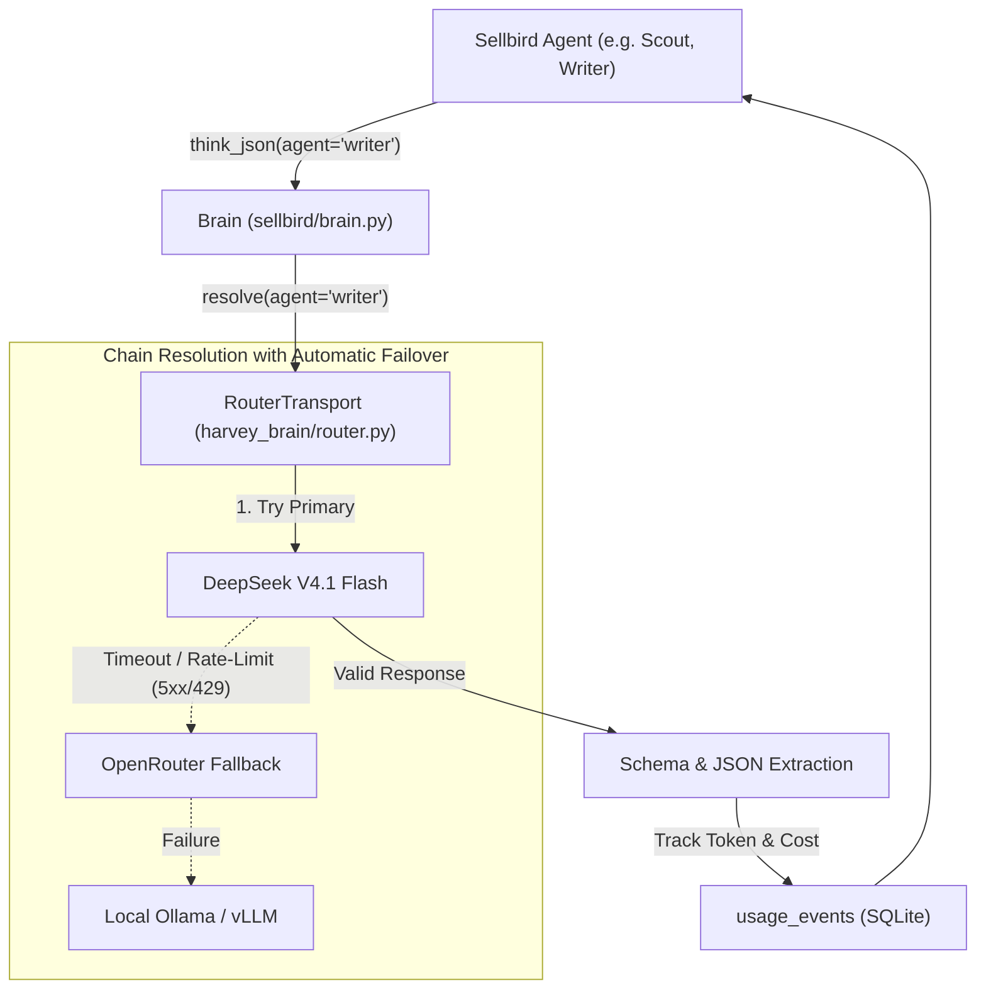

# 🦅 Harvey Agent (Sellbird) — Master Handoff & Small Model Operating Guide

```
  ███████╗███████╗██╗     ██╗     ██████╗ ██╗██████╗ ██████╗ 
  ██╔════╝██╔════╝██║     ██║     ██╔══██╗██║██╔══██╗██╔══██╗
  ███████╗█████╗  ██║     ██║     ██████╔╝██║██████╔╝██║  ██║
  ╚════██║██╔══╝  ██║     ██║     ██╔══██╗██║██╔══██╗██║  ██║
  ███████║███████╗███████╗███████╗██████╔╝██║██║  ██║██████╔╝
  ╚══════╝╚══════╝╚══════╝╚══════╝╚═════╝ ╚═╝╚═╝  ╚═╝╚═════╝ 
  ── AUTONOMOUS AI OUTREACH & MULTI-AGENT GTM PLATFORM ──────
```

> **Target Audience**: This document is specifically engineered as a complete, self-contained handoff for **developers** and **smaller AI models (e.g., DeepSeek V4.1 Flash, Qwen 2.5, Llama 3)** that need explicit, step-by-step guidance, full context, exact commands, and architecture rules to operate, debug, and expand this codebase without ambiguity.

---

## 1. System Overview & Executive Summary

**Harvey Agent** (consolidated and developed on the `sellbird` open-source codebase, licensed under AGPL-3.0) is a fully autonomous, local-first Outbound Sales & Go-To-Market (GTM) execution engine.

### Core Superpowers & Key Upgrades
1. **Zero `claude login` Requirement**: Any model with an OpenAI-compatible endpoint (`/chat/completions`) can power the entire pipeline. Models like **DeepSeek V4.1 Flash**, **Gemini 2.5/3.8 Flash**, **Groq Llama 3.3**, or local **Ollama / vLLM** run natively.
2. **Provider Failover & Cost-Aware Routing (`harvey_brain`)**: A multi-tiered fallback chain automatically fails over from primary models to secondary providers upon timeouts or rate limits. Per-role routing allows assigning lightweight, fast models (DeepSeek Flash) to high-volume prospecting/scoring while routing creative copywriting to reasoning models.
3. **Stealth OSINT Scraping Waterfall**: 3-tier SSRF-guarded fetch engine combining `curl_cffi` (browser TLS impersonation), headless Playwright (SPA execution), and `trafilatura` for clean, ads-free Markdown extraction.
4. **Clay-Style Custom AI Columns**: Dynamically create custom enrichment columns in SQLite v18, execute autonomous AI web investigations per lead, and display them in the web dashboard.
5. **Auto-Booking & Multi-Channel Integrations**: Live Cal.com API v2 / Google Calendar slot matching, Twenty CRM synchronization, and instant Telegram/Slack operator copilot alerts.
6. **Deliverability & Safety Firewall**: CopyCritic agent verifies all emails before sending, preventing hallucinated facts, spam trigger phrases, and unresolved merge-tag traps (`{{first_name}}`).

---

## 2. Quick Start: How to Run and Test

The environment uses **Python 3.13** inside the virtual environment located at `sellbird/.venv`.

### 2.1 Activate Virtual Environment & Check Status
```powershell
# In Windows PowerShell:
cd "c:\Users\Ali Tariq\Desktop\Harvey Agent\sellbird"
& ".\.venv\Scripts\Activate.ps1"

# Verify CLI is functional and inspect the banner:
python -m sellbird.cli
```

### 2.2 Configure AI Model Keys (`.env` & `brain.yaml`)
To run with **DeepSeek V4.1 Flash** (or any OpenAI-compatible API):
1. Open `.env` (or configure via Dashboard Settings):
```env
DEEPSEEK_API_KEY=sk-your-deepseek-key-here
# Or for a custom / local OpenAI-compatible endpoint:
# OPENAI_BASE_URL=https://api.deepseek.com/v1
# OPENAI_MODEL=deepseek-chat
# OPENAI_API_KEY=sk-your-key-here
```

2. Review `brain.yaml` (located at `sellbird/brain.yaml`):
```yaml
budget:
  max_usd_per_day: 5.0

chain:
  - provider: deepseek
    model: deepseek-chat
    api_key_env: DEEPSEEK_API_KEY
  - provider: openrouter
    model: deepseek/deepseek-chat
    api_key_env: OPENROUTER_API_KEY

profiles:
  scout:
    model: deepseek-chat
    temperature: 0.1
  writer:
    model: deepseek-chat
    temperature: 0.7
  researcher:
    model: deepseek-chat
    temperature: 0.2
  enricher:
    model: deepseek-chat
    temperature: 0.2
  critic:
    model: deepseek-chat
    temperature: 0.0
```

### 2.3 Run Diagnostic Checks
```powershell
# 1. Run Brain Doctor (verifies all configured model providers)
python -m sellbird.cli brain doctor

# 2. Run Live Probe (sends a 1-token test prompt through Scout role)
python -m sellbird.cli brain probe scout stripe.com

# 3. Check Overall Pipeline Status
python -m sellbird.cli status
```

### 2.4 Start the Web Dashboard
```powershell
python -m sellbird.cli dashboard --open
# Opens http://127.0.0.1:5555 with OLED Dark Mode, Brain Studio & Clay AI
```

### 2.5 Start the Autonomous Outbound Loop
```powershell
python -m sellbird.cli run
```

---

## 3. Repository Architecture & Directory Layout

```
Harvey Agent/
├── sellbird/                     # Consolidated package root
│   ├── .env                      # Local credentials (API keys, ports, secrets)
│   ├── brain.yaml                # Brain router fallback chain & role profiles
│   ├── pyproject.toml            # Project dependencies & CLI entrypoints
│   │
│   ├── harvey_brain/             # Universal LLM Router Engine
│   │   ├── __init__.py           # Brain public exports
│   │   ├── spec.py               # Provider specifications (DeepSeek, Groq, xAI, etc.)
│   │   ├── config.py             # Config loader, brain.yaml & .env discovery
│   │   ├── openai_compat.py      # Universal OpenAI /chat/completions transport
│   │   ├── router.py             # Multi-provider fallback loop & budget tracking
│   │   ├── profile.py            # Per-role overrides (scout, writer, researcher)
│   │   ├── router_factory.py     # Factory constructing RouterTransport from config
│   │   ├── schemas.py            # Strict task JSON schemas & 400 auto-downgrade
│   │   └── probe.py              # CLI diagnostic probe
│   │
│   ├── sellbird/                 # Main Application Logic
│   │   ├── main.py               # 15-minute heartbeat loop & Windows signal control
│   │   ├── cli.py                # Command line interface & ASCII art banner
│   │   ├── dashboard.py          # FastAPI web server (:5555) & REST API
│   │   ├── brain.py              # Bridge connecting Sellbird host to harvey_brain
│   │   ├── state.py              # SQLite StateManager (v18 schema, WAL mode)
│   │   ├── site_facts.py         # Company observation & facts extraction
│   │   │
│   │   ├── agents/               # Multi-Agent Roster
│   │   │   ├── scout.py          # ICP qualification & decision-maker discovery
│   │   │   ├── writer.py         # Cold email copywriting & sequence generator
│   │   │   ├── researcher.py     # Autonomous OSINT deep web investigation
│   │   │   ├── enricher.py       # Clay-style custom AI column evaluator
│   │   │   ├── critic.py         # Hallucination, spam & merge-tag reviewer
│   │   │   ├── sender.py         # Multi-inbox rotation & rate-limited delivery
│   │   │   ├── handler.py        # Bounce processing, reply reading & auto-booking
│   │   │   └── analyst.py        # Pipeline analytics & funnel metrics
│   │   │
│   │   ├── integrations/         # Third-Party Connectors
│   │   │   ├── stealth_fetch.py  # 3-tier SSRF-guarded stealth web scraper
│   │   │   ├── calendar.py       # Cal.com v2, Google Calendar & M365 booking
│   │   │   ├── crm_sync.py       # Twenty CRM REST/GraphQL & Webhook sync
│   │   │   ├── copilot.py        # Telegram Bot API & Slack webhook alerts
│   │   │   ├── gmail.py          # Google Workspace OAuth2 email sender
│   │   │   ├── microsoft.py      # Microsoft Graph OAuth2 email sender
│   │   │   ├── smtp_mail.py      # Custom SMTP/IMAP mailbox provider
│   │   │   └── email_finder.py   # Pattern discovery & MX validation
│   │   │
│   │   └── web/                  # Premium OLED Dark Dashboard
│   │       ├── index.html        # Glassmorphic UI layout & modal dialogs
│   │       ├── app.js            # Frontend controllers (Brain Studio, Clay AI)
│   │       └── app.css           # OLED black (#020617) & glass styling
│   │
│   ├── tests/                    # Comprehensive Pytest Suite
│   │   ├── test_brain_v2.py      # 16 tests for Brain router & provider spec
│   │   ├── test_steroid_features.py # 33 tests for stealth fetch, OSINT, Clay, etc.
│   │   └── test_dashboard_brain_and_windows.py # 4 tests for dashboard & stop control
│   │
│   └── data/                     # Local SQLite Storage & Logs
│       └── sellbird.db           # SQLite DB (Schema v18 with enrichment tables)
```

---

## 4. Subsystem Deep Dive: How the Core Works

### 4.1 Brain Router v2 (`harvey_brain`)



- **Per-Call Model Overrides**: When `scout` runs, `profile.py` overrides the request model to `deepseek-chat` and temperature to `0.1` without rebuilding the transport.
- **Strict Structured Output & Auto-Downgrade**: If an endpoint rejects `json_schema` strict mode with HTTP 400 or 422, `OpenAICompatTransport` automatically downgrades to `json_object` and retries seamlessly.
- **Budget Protection**: Daily spend is accumulated in SQLite. If cumulative spend hits `max_usd_per_day` (default `$5.00`), further LLM calls pause to prevent runaway billing.

### 4.2 3-Tier Stealth Web Waterfall (`stealth_fetch.py`)
When researching a company website or scraping job listings:
1. **Tier 1 — `curl_cffi`**: Performs HTTP requests with TLS browser fingerprints (Chrome 120 / Safari 17) to bypass Cloudflare and basic anti-bot blocks at zero cost.
2. **Tier 2 — Headless Playwright**: If HTML is an empty Single Page App shell (`is_spa_shell`), renders JavaScript locally.
3. **Tier 3 — Firecrawl / Jina Reader**: Cloud fallback for difficult anti-bot systems.
4. **Mandatory SSRF Guard**: `validate_public_url()` blocks loopback (`127.0.0.1`, `localhost`), link-local (`169.254.169.254`), private IP subnets (`10.0.0.0/8`, `172.16.0.0/12`, `192.168.0.0/16`), and non-HTTP protocols.

### 4.3 Clay-Style Custom AI Columns (`enricher.py`)
Allows users to define dynamic columns like *"Tech Stack Analysis"* or *"Founder Background"*:
- Columns are defined in `enrichment_columns` (SQLite).
- `ClayEnricher` runs on un-enriched leads, collects domain facts, prompts the model (`agent="enricher"`), and stores structured outputs in `enrichment_values`.

### 4.4 Deliverability & Safety Critic (`critic.py`)
Before any email is staged to `outbox`:
1. Scans for template leakage: literal `{{first_name}}`, `{{company}}`, `[First Name]`.
2. Scans for spam keywords: *"guaranteed 100%"*, *"no risk"*, *"make money fast"*.
3. Verifies that claims cite actual signals stored in `companies.signals`.
4. If issues are found, prompts the Critic role to repair the email copy automatically.

---

## 5. Golden Rules for Smaller Models (DeepSeek V4.1 Flash)

When writing code or adding features to this repository, smaller reasoning models **MUST** strictly adhere to the following rules:

1. **Defensive Dict Extraction**: Never assume LLM JSON output is cleanly formatted. Always parse with `sellbird.brain._extract_json()` and handle both `list` and `dict` top-level wrapping.
2. **Backward-Compatible Signatures**: When adding keyword arguments to agent methods (e.g., `company_id`), always provide default values (`company_id: str = ""`) and wrap calls in `try/except TypeError` so mock fixtures in existing tests don't break.
3. **SQLite WAL Mode & Connection Pool**: Always access SQLite via `StateManager` or `storage.connect(path)` with `PRAGMA synchronous=NORMAL` and `busy_timeout=5000`. Never hold open long transactions across async `await` sleeps.
4. **Mandatory URL SSRF Validation**: Any web fetching feature **must** call `validate_public_url(url)` before sending an HTTP request.
5. **Clean Resource Lifecycles**: Always call `await brain.aclose()` inside `finally` blocks to close active `httpx.AsyncClient` connection pools and avoid socket leaks.
6. **No Raw Emojis in Dashboard UI**: Per UI design standards, use clean SVG icons (`<svg class="icon"><use href="#icon-id"/></svg>`) instead of Unicode emojis.

---

## 6. Test Suite Verification Reference

Run the comprehensive test suite at any time to verify system integrity:

```powershell
# Run all custom steroid, brain v2, and dashboard tests (53 tests):
& ".\.venv\Scripts\pytest.exe" tests/test_brain_v2.py tests/test_steroid_features.py tests/test_dashboard_brain_and_windows.py -q

# Run full project test suite (3,600+ tests):
& ".\.venv\Scripts\pytest.exe" tests/ -q
```
