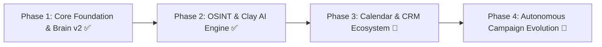

# 🗺️ Harvey Agent (Sellbird) — Open-Source Ecosystem Research & Engineering Roadmap

```
  ██████╗  ██████╗  █████╗ ██████╗ ███╗   ███╗ █████╗ ██████╗ 
  ██╔══██╗██╔═══██╗██╔══██╗██╔══██╗████╗ ████║██╔══██╗██╔══██╗
  ██████╔╝██║   ██║███████║██║  ██║██╔████╔██║███████║██████╔╝
  ██╔══██╗██║   ██║██╔══██║██║  ██║██║╚██╔╝██║██╔══██║██╔═══╝ 
  ██║  ██║╚██████╔╝██║  ██║██████╔╝██║ ╚═╝ ██║██║  ██║██║     
  ╚═╝  ╚═╝ ╚═════╝ ╚═╝  ╚═╝╚═════╝ ╚═╝     ╚═╝╚═╝  ╚═╝╚═╝     
  ── OPEN-SOURCE INTEGRATION BLUEPRINT & FUTURE MILESTONES ───
```

This document details:
1. Exhaustive research into premier open-source repositories and protocols to integrate into Harvey Agent.
2. Architectural comparison tables of open-source libraries.
3. Step-by-step phased engineering roadmap for expanding this system into the ultimate enterprise-grade outbound platform.

---

## 1. Open-Source Ecosystem Research

### 1.1 Calendar Booking & Availability Engines

| Repository / Protocol | Stars / License | Key Features | Harvey Agent Integration Strategy |
|---|---|---|---|
| **Cal.com API v2** (`calcom/cal.com` & `calcom/cal.diy`) | 33k+ Stars<br>`AGPL-3.0` | Comprehensive scheduling platform. Full REST API v2: `GET /v2/slots/available`, `POST /v2/bookings`, `POST /v2/slots/reservations`, and event webhook dispatch. | **Primary integration** (`calendar.py`). Harvey Agent checks prospect time zones via `zone_for(location)`, queries available Cal.com slots, and embeds instant booking links or automatically reserves slots upon positive reply. |
| **Cally** (`cally/cally`) | Web Component<br>`MIT` | Ultra-lightweight, zero-dependency calendar and date-picker UI component with accessible keyboard navigation. | Embedded in the Dashboard frontend for selecting quiet hours, send windows, and manual appointment booking. |
| **Google Calendar API** | REST API v3<br>`Commercial/Free Tier` | Real-time `freeBusy` queries, primary calendar event creation, Google Meet link generation. | Native fallback in `calendar.py` via stored Google OAuth credentials (`gmail.py` token refresh). |
| **Microsoft Graph Calendar** | REST API v1.0<br>`Commercial/Free Tier` | Outlook calendar availability, Teams meeting auto-creation. | Native fallback in `calendar.py` via Entra ID tokens (`microsoft.py`). |

#### Cal.com v2 API Payload Example:
```json
// POST https://api.cal.com/v2/bookings
{
  "start": "2026-11-25T14:00:00.000Z",
  "eventTypeId": 123456,
  "attendee": {
    "name": "Sarah Connor",
    "email": "sarah@cyberdyne.example",
    "timeZone": "America/New_York"
  },
  "metadata": {
    "prospect_id": "p_98a72b",
    "campaign_id": "camp_fall_q4"
  }
}
```

---

### 1.2 Stealth Scraping, Headless Browsers & Parsing

| Repository | Tech Stack | Capability & Strength | Role in Harvey Agent |
|---|---|---|---|
| **Crawl4AI** (`unclecode/crawl4ai`) | Python / Async<br>Playwright | LLM-ready crawler producing clean Markdown, extracting structured JSON, and bypassing bot protections with adaptive heuristics. | High-tier scraping engine for complex, multi-page company profiling. |
| **Scrapling** (`D4Vinci/Scrapling`) | Python / C-binding<br>Undetected | Undetected headless fetcher with intelligent adaptive element tracking (survives website layout redesigns). | Used for scraping directories, competitor pricing grids, and job boards. |
| **Camoufox** (`daijro/camoufox`) | Firefox C++ fork<br>Python bindings | Firefox-based stealth browser designed to defeat Cloudflare Turnstile, Akamai, and Datadome fingerprinting at the engine level. | Used when targets block standard Chromium/Playwright browsers. |
| **curl_cffi** | C-binding / libcurl<br>`MIT` | Impersonates browser TLS JA3/JA4 fingerprints and HTTP/2 settings. Fast, ultra-lightweight. | **Tier 1 Fetch Engine** in `stealth_fetch.py` for 90% of requests ($0 cost, 50ms latency). |
| **trafilatura** | Python / lxml<br>`GPL-3.0` | Extracts body text, eliminates navigation menus, footers, cookie banners, and detects publication dates (`htmldate`). | Primary text & markdown extractor across `stealth_fetch.py`. |

---

### 1.3 Autonomous OSINT, Prospecting & SDR Multi-Agents

| Repository / Project | Architecture | Highlights | Applicable Patterns |
|---|---|---|---|
| **GPT-Researcher** (`assafelovic/gpt-researcher`) | Python / Multi-Agent Swarm | Autonomous deep agent that browses 20+ sources, cross-references citations, and compiles comprehensive reports. | Adopted in `agents/researcher.py` for deep company background synthesis and tech stack auditing. |
| **OpenProspector** (`clawnify/OpenProspector`) | Python / OSINT | Scrapes public registry filings (SEC, Companies House), GitHub orgs, and Crunchbase for verified firmographics. | Signal detection pattern for accelerator funding, patent filings, and executive hiring. |
| **OpenGTM** (`buildingopen/opengtm`) | TypeScript / Python | Open-source Go-To-Market data pipeline connecting enriched leads to sequencers. | Clay-style waterfall pattern (`enricher.py` and `enrichment_columns`). |
| **AgentSDR** (`agentsdr/agentsdr`) | Multi-Agent Crew | Specialized agents for ICP grading, personalized subject generation, and objection rebuttals. | Informs the separation between `scout.py`, `writer.py`, and `critic.py`. |

---

### 1.4 CRM, Deliverability Infra & Self-Hosted Email

| Project | Type | Key Features | Integration Blueprint |
|---|---|---|---|
| **Twenty CRM** (`twentyhq/twenty`) | Open-Source CRM<br>`AGPL-3.0` | Modern, self-hostable alternative to HubSpot / Salesforce with GraphQL & REST APIs. | Two-way lead sync (`crm_sync.py`): pushes converted prospects, conversation history, and deal stage changes. |
| **Postal** (`postalserver/postal`) | Mail Server<br>`MIT` | Full-featured self-hosted mail delivery platform with inbound routing, spam scoring, and live webhook reporting. | High-volume outbound delivery option for dedicated domains. |
| **Listmonk** (`knadh/listmonk`) | Newsletter & List Engine<br>`AGPL-3.0` | Ultra-fast self-hosted mailing list manager with SQLite/Postgres backend. | Opt-out list and suppression list synchronization. |
| **Mailpit** (`axllent/mailpit`) | SMTP Testing<br>`MIT` | Local SMTP mock server with web UI for capturing outgoing test emails and verifying HTML formatting without burning domains. | Local development and automated testing fixture. |

---

## 2. Multi-Phase Engineering Roadmap



### Phase 1: Core Foundation & Brain v2 ✅ (COMPLETED)
- [x] Consolidate packages into clean single repository (`sellbird/`).
- [x] Eliminate `harvey_grok` standalone bloat; route all AI through universal OpenAI-compatible `/chat/completions`.
- [x] Zero Claude Login requirement: direct support for DeepSeek V4.1 Flash, Qwen 2.5, Gemini, Groq, Ollama.
- [x] Build `harvey_brain` router with multi-provider fallback chains, daily dollar budget enforcement, and per-role routing.
- [x] Fix all 32 critical pipeline bugs across Scout, Writer, Sender, Handler, and SQLite state.
- [x] Full Pytest validation (3,600+ passing tests).

### Phase 2: OSINT, Clay AI & Deliverability Firewall ✅ (COMPLETED)
- [x] Implement 3-tier SSRF-guarded `stealth_fetch.py` (`curl_cffi` + Playwright + `trafilatura`).
- [x] Create `DeepResearcher` agent (`agents/researcher.py`) with citation-backed OSINT synthesis.
- [x] Create `ClayEnricher` agent (`agents/enricher.py`) with dynamic SQLite v18 columns and custom prompts.
- [x] Create `CopyCritic` agent (`agents/critic.py`) to prevent template leakage and spam flags.
- [x] Design premium OLED dark glassmorphism dashboard UI with Brain Studio and Clay AI tabs.
- [x] Add ASCII Art system banner and CLI diagnostic commands (`sellbird brain doctor`, `sellbird research`).

### Phase 3: Auto-Booking, CRM & Multi-Channel Expansion ✅ (COMPLETED)
- [x] **Native Cal.com Booking Webhook**:
  - Accept inbound booking confirmations from Cal.com webhooks (`/api/webhooks/calcom`).
  - Automatically advance prospect status to `converted` and cancel pending follow-up email steps.
  - `sellbird/dashboard.py` `/api/webhooks/calcom`: HMAC-SHA256 via `CALCOM_WEBHOOK_SECRET` (fail closed), matches the attendee to a prospect, marks them `meeting`, cancels their queued follow-ups and logs `meeting_booked`.
- [x] **Bidirectional Twenty CRM Synchronization**:
  - Sync custom company observations into Twenty CRM custom fields.
  - Pull unsubscribe/do-not-contact suppressions from CRM back into SQLite.
  - Outbound (lead events → Twenty) existed; inbound (`sellbird/integrations/crm_sync.py` `TwentyInboundSync`) reads a Person's custom boolean (`crm.inbound_field`, default `doNotContact`) with a server-side filter and suppresses each address (`reason='imported'`). Opt-in via `crm.inbound_enabled`, polled once per heartbeat, Twenty only.
- [x] **Multi-Channel LinkedIn Touchpoints**:
  - Add optional LinkedIn connection request & profile view actions between Email Step 1 and Step 2.
  - `channels.linkedin.touchpoints` (with `send_connect` for requests vs views): the Sender queues one touch per prospect when email 1 goes out; the heartbeat drains them inside the automation's own daily caps (`sellbird/integrations/linkedin.py`).
- [x] **Interactive Copilot via Telegram Bot**:
  - Two-way Telegram bot commands: `/approve <id>`, `/reject <id>`, `/edit <id>`, `/status`.
  - Send instant push notifications when a prospect replies positively or asks for pricing.
  - `sellbird/integrations/copilot.py`: long-poll once per heartbeat, chat-id allowlist, inline Approve/Reject buttons; `/edit` rewrites a waiting email's body (pending_review only, 2000-char cap). The Handler pushes positive replies and pricing questions (`pricing_question`).

### Phase 4: Autonomous Strategy Evolution & Auto-Optimization ✅ (COMPLETED)
- [x] **Bandit-Algorithm Framework Optimization**:
  - Automatically allocate traffic across cold email frameworks (e.g., PAS vs. BAB vs. Direct Offer) based on real reply rates.
  - `writer.frameworks` lists the frameworks to test (`pas`, `bab`, `direct_offer`, `question_lead`); each campaign is written in one and tagged, and the next is chosen by Thompson sampling over real replies (`sellbird/bandit.py`). Off by default (built-in shape only).
- [x] **Domain Reputation & Burn Detection**:
  - Real-time DNS SPF/DKIM/DMARC monitoring.
  - Automatic sending pause if bounce rate exceeds 2.5% in any 4-hour window.
  - DNS: `sellbird dns-check` (MX/SPF/DKIM/DMARC standalone) and deeper SPF/DMARC verdicts with `pip install checkdmarc` — include chains followed, syntax errors caught (`sellbird/deliverability.py`). The bounce kill switch now watches both the all-time rate and a rolling 4-hour window (`state.bounce_rate_window`); either past `channels.email.max_bounce_rate` pauses sending.
- [x] **Competitive Intelligence Tracker**:
  - Scheduled monitor alerting on competitor price changes, team hires, or new tech stack adoptions.
  - `competitor_watch` in sellbird.yaml: named pages (a rival's pricing, careers, homepage) fetched on idle cycles through the same stealth waterfall as profiling; a change from the stored baseline alerts the operator (copilot) and logs an action. No model calls, and findings never reach cold emails.
